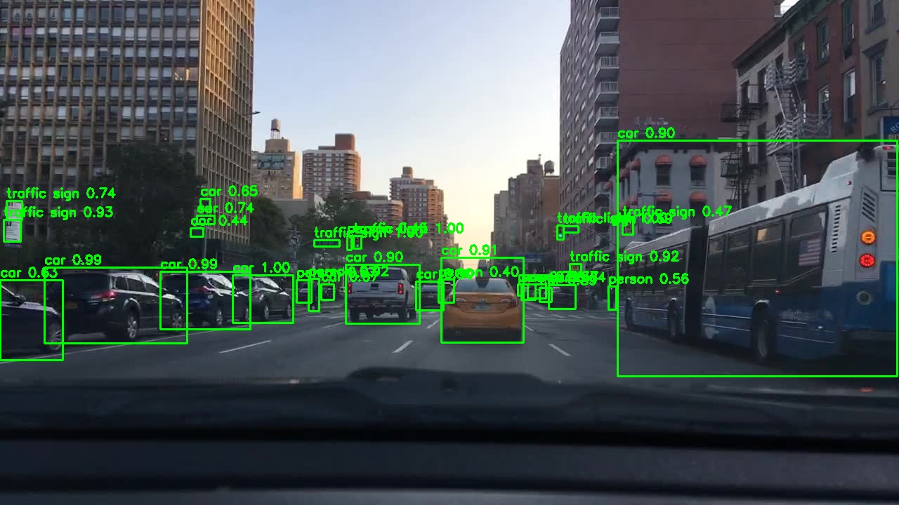
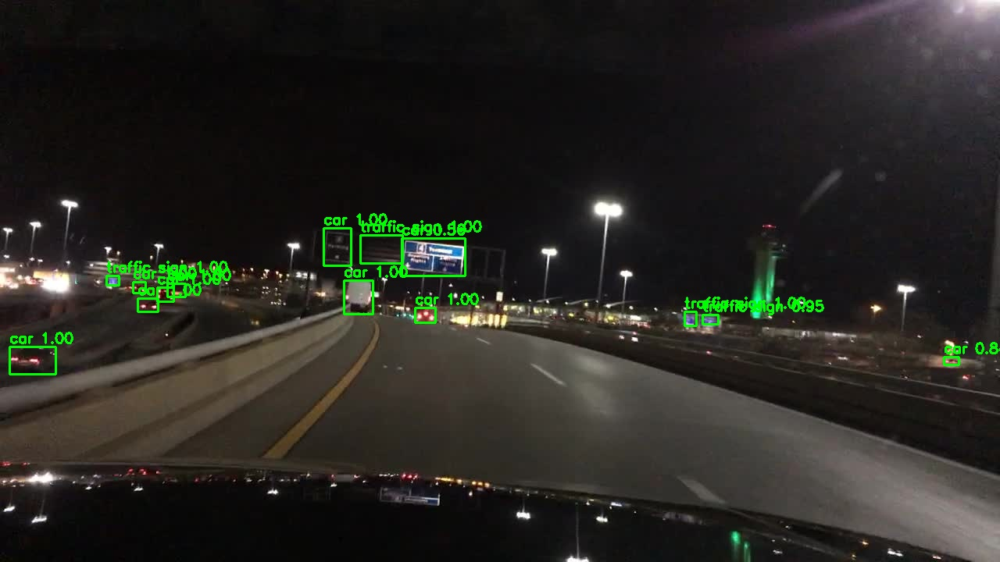

# ML-09: Object Detection I (R-CNN และ Fast R-CNN)

โปรเจกต์นี้ศึกษาแนวคิดของ **R-CNN** และ **Fast R-CNN** ด้วย Python และ TensorFlow/Keras บนชุดข้อมูล **BDD100K** (ภาพจากกล้องหน้ารถยนต์) ครอบคลุมการเทรนโมเดล การประเมินผล การทดสอบกับภาพ และการทดสอบแบบเรียลไทม์ด้วยเว็บแคม

> **ข้อควรทราบ:** โค้ดเป็น *รุ่นเพื่อการเรียนรู้* (simplified educational implementation) ไม่ใช่ R-CNN / Fast R-CNN เต็มรูปแบบ ดูรายละเอียดในหัวข้อ [6. ข้อจำกัด](#6-ข้อจำกัด)

## 1. ภาพรวม

| โมเดล | แนวคิดที่จำลอง | ลักษณะของโค้ดในโปรเจกต์ |
|---|---|---|
| `01-R-CNN` | ตัดภาพตามบริเวณ (region) แล้วส่งแต่ละบริเวณเข้า CNN แยกกัน | CNN 3 ชั้น + `GlobalAveragePooling2D` จำแนก crop ขนาด 64×64 |
| `02-Fast-R-CNN` | ใช้ feature map แล้วทำ pooling ขนาดคงที่ต่อบริเวณ (ROI pooling) | CNN 3 ชั้น + `MaxPooling2D(4)` + `Flatten` จำแนก crop ขนาด 64×64 |

ทั้งสองโมเดลใช้ข้อมูลชุดเดียวกัน และแต่ละโฟลเดอร์มีสคริปต์เทรน ประเมินผล ทดสอบภาพ และทดสอบเรียลไทม์แยกจากกัน

## 2. ชุดข้อมูล

ใช้ [BDD100K (รูปแบบ YOLO) จาก Kaggle](https://www.kaggle.com/datasets/a7madmostafa/bdd100k-yolo) มี 10 คลาส:
`person`, `rider`, `car`, `bus`, `truck`, `bike`, `motor`, `traffic light`, `traffic sign`, `train`

| ส่วนข้อมูล | จำนวนภาพ |
|---|---:|
| Train | 70,000 |
| Validation | 10,000 |
| Test | มีในชุดข้อมูล (ไม่ได้ระบุจำนวน) |

แต่ละภาพมีไฟล์ label ชื่อเดียวกัน (`.txt`) รูปแบบ YOLO: `class x_center y_center width height` (ค่า 0–1) สคริปต์แปลงเป็นพิกเซลแล้วตัดภาพตามกรอบ (crop) ปรับเป็น 64×64 เพื่อใช้เทรนและประเมินผล

## 3. โครงสร้างโปรเจกต์

```text
ML-09-Object Detection I/
├── dataset/
│   ├── train/{images,labels}/
│   ├── val/{images,labels}/
│   ├── test/{images,labels}/
│   └── data.yaml
├── 01-R-CNN/
│   ├── train.py          # เทรนและบันทึก outputs/model.keras
│   ├── evaluate.py       # ประเมินผลบนชุด crop (แสดงผลทางหน้าจอ)
│   ├── image_test.py     # ทดสอบกับภาพและบันทึก outputs/image_result.jpg
│   ├── realtime_test.py  # ทดสอบด้วยเว็บแคม
│   └── outputs/
├── 02-Fast-R-CNN/
│   ├── train.py
│   ├── evaluate.py       # บันทึกผลลง outputs/evaluation.json ด้วย
│   ├── image_test.py
│   ├── realtime_test.py
│   └── outputs/
├── requirements.txt
└── README.md
```

> โฟลเดอร์ `dataset/` ต้องดาวน์โหลดเองและวางตามโครงสร้างข้างต้น (ไม่รวมอยู่ใน repository)

## 4. วิธีใช้งาน

ติดตั้งไลบรารี (TensorFlow 2.15 ถึงต่ำกว่า 2.20):

```bash
pip install -r requirements.txt
```

จากนั้นเข้าไปในโฟลเดอร์ของโมเดลที่ต้องการ (`01-R-CNN` หรือ `02-Fast-R-CNN`) แล้วรันตามลำดับ

| ขั้นตอน | คำสั่ง | ผลลัพธ์ |
|---|---|---|
| 1. เทรน | `python train.py --limit 200 --epochs 50` | `outputs/model.keras` |
| 2. ประเมินผล | `python evaluate.py --limit 200 --split test` | ค่า accuracy, precision, recall, F1 และ classification report |
| 3. ทดสอบกับภาพ | `python image_test.py` | `outputs/image_result.jpg` |
| 4. ทดสอบเรียลไทม์ | `python realtime_test.py --camera 0 --threshold 0.85 --regions 25` | หน้าต่างวิดีโอ (กด **Q** เพื่อออก) |

พารามิเตอร์ที่ใช้บ่อย: `--limit` จำนวนภาพต้นทางที่ใช้ (0 = ทั้งหมด), `--epochs` จำนวนรอบการเทรน, `--split` เลือก `train`/`val`/`test`

**การทดสอบกับภาพ** ทำได้สองแบบ
```bash
python image_test.py                 # สุ่มภาพที่มี label จาก dataset/test
python image_test.py --split val     # สุ่มจาก dataset/val
python image_test.py --image "<พาธไฟล์ภาพ>"   # ระบุภาพเอง
```
`image_test.py` ไม่เปิดหน้าต่างแสดงภาพ ให้เปิดไฟล์ `outputs/image_result.jpg` ดูเอง และไฟล์นี้จะถูกเขียนทับทุกครั้งที่รัน ภาพที่ใช้ทดสอบต้องมีไฟล์ label ชื่อเดียวกันอยู่ใน `dataset/<split>/labels/` เพราะสคริปต์ใช้กรอบจากไฟล์ label

## 5. ผลการทดลอง

### 5.1 ผลเชิงปริมาณ

ประเมินบนชุด `test` (crop 3,528 รายการ) เป็นการ **จำแนกคลาสของ crop** ไม่ใช่ mAP ของงานตรวจจับวัตถุ

| ตัวชี้วัด | R-CNN | Fast R-CNN |
|---|---:|---:|
| Accuracy | 0.7690 | 0.7894 |
| Precision (macro) | 0.34 | 0.3458 |
| Recall (macro) | 0.27 | 0.3184 |
| F1 (macro) | 0.27 | 0.3283 |
| ขนาดไฟล์โมเดล | ≈ 1.4 MB | ≈ 4.3 MB |

ค่าของ Fast R-CNN มาจาก `02-Fast-R-CNN/outputs/evaluation.json` ส่วนค่าของ R-CNN มาจากผลที่ `evaluate.py` แสดงทางหน้าจอ (สคริปต์นี้ไม่บันทึกไฟล์) รันด้วยคำสั่ง `python evaluate.py --limit 200 --split test` เหมือนกันทั้งสองโมเดล

**ผลรายคลาส (F1-score)** จำนวนตัวอย่าง (support) ในชุด test ที่ใช้ประเมินมีดังนี้

| คลาส | Support | R-CNN | Fast R-CNN |
|---|---:|---:|---:|
| person | 213 | 0.39 | 0.50 |
| rider | 17 | 0.00 | 0.00 |
| car | 1,947 | 0.86 | 0.87 |
| bus | 27 | 0.00 | 0.05 |
| truck | 76 | 0.05 | 0.26 |
| bike | 17 | 0.00 | 0.08 |
| motor | 8 | 0.00 | 0.00 |
| traffic light | 516 | 0.74 | 0.75 |
| traffic sign | 707 | 0.70 | 0.77 |
| train | 0 | 0.00 | 0.00 |

### 5.2 ผลเชิงคุณภาพ (ภาพตัวอย่าง)

| R-CNN | Fast R-CNN |
|---|---|
|  |  |

ทั้งสองภาพเป็นภาพคนละภาพ (สุ่มแยกกัน) จึงใช้เปรียบเทียบความแม่นยำของสองโมเดลโดยตรงไม่ได้ กรอบสีเขียวคือกรอบจริงจากไฟล์ label ส่วนข้อความคือคลาสที่โมเดลทายพร้อมค่าความมั่นใจ

### 5.3 การวิเคราะห์

- **Fast R-CNN ดีกว่า R-CNN เล็กน้อย:** accuracy 0.789 เทียบกับ 0.769 และ macro F1 0.328 เทียบกับ 0.274 ความต่างชัดที่สุดในคลาสที่มีตัวอย่างน้อยถึงปานกลาง เช่น `truck` (F1 0.26 เทียบกับ 0.05) และ `person` (0.50 เทียบกับ 0.39) ส่วนคลาสใหญ่อย่าง `car` ทั้งสองโมเดลได้ใกล้เคียงกัน (0.86–0.87) ผลนี้มาจากการรันครั้งเดียว ความต่างระดับนี้จึงยังไม่ถือเป็นข้อสรุปแน่ชัด
- **Accuracy สูงแต่ macro F1 ต่ำ เพราะคลาสไม่สมดุล:** `car` มี 1,947 จาก 3,528 ตัวอย่าง (ประมาณ 55%) และ `car`, `traffic light`, `traffic sign` รวมกันเกือบ 90% โมเดลจึงทายสามคลาสนี้ได้ดี (F1 0.70–0.87) แต่คลาสหายากอย่าง `rider`, `motor` ได้ F1 เป็น 0 ในทั้งสองโมเดล และ R-CNN ทาย `bus`, `bike` ไม่ถูกเลย
- **R-CNN แทบไม่ทาย `truck` ได้:** precision 0.67 แต่ recall เพียง 0.03 หมายความว่ารถบรรทุกส่วนใหญ่ถูกทายเป็นคลาสอื่น (น่าจะเป็น `car`) สอดคล้องกับภาพตัวอย่างที่รถบัสถูกทายเป็น `car`
- **Macro F1 ถูกดึงลงด้วยคลาส `train`:** ชุด test ที่ใช้ประเมินไม่มีตัวอย่างคลาส `train` เลย (support = 0) แต่สคริปต์นับคลาสนี้เป็น 0 ในค่าเฉลี่ย macro จึงทำให้ค่า macro ต่ำกว่าที่ควรราว 10% (หากเฉลี่ยเฉพาะ 9 คลาสที่มีตัวอย่าง Fast R-CNN ≈ 0.36 และ R-CNN ≈ 0.30)
- **พบการทายผิดในภาพตัวอย่างของ R-CNN:** รถบัสคันใหญ่ด้านขวาของภาพถูกทายเป็น `car` (0.90) แสดงว่าโมเดลแยกคลาสยานพาหนะที่หน้าตาคล้ายกันได้ไม่ดี ซึ่งเป็นผลที่คาดได้จากโมเดลขนาดเล็กและข้อมูลเทรนจำนวนจำกัด
- **ค่าความมั่นใจสูงไม่ได้แปลว่าถูกต้อง:** ในภาพกลางคืนของ Fast R-CNN หลายกรอบมีความมั่นใจ 1.00 แต่การตัดสินความถูกต้องต้องเทียบกับ label ไม่ใช่ดูจากค่านี้
- **ผลลัพธ์ขึ้นกับจำนวนข้อมูล:** ค่า `--limit` ที่ใช้เทรนและประเมินมีผลมาก การใช้ภาพจำนวนน้อยทำให้คลาสหายาก (เช่น `rider`, `motor`, `bike`) มีตัวอย่างไม่พอ
- **ความต่างของสถาปัตยกรรม:** Fast R-CNN ใช้ `Flatten` หลัง pooling ทำให้มีพารามิเตอร์มากกว่า (ไฟล์โมเดลใหญ่กว่าราว 3 เท่า) แต่ในโค้ดนี้ทั้งสองโมเดลรับ crop ที่ตัดมาแล้ว จึงไม่เห็นข้อได้เปรียบด้านความเร็วที่แท้จริงของ Fast R-CNN (การคำนวณ feature map ร่วมกันทั้งภาพ)

## 6. ข้อจำกัด

1. **ไม่ใช่ detection เต็มรูปแบบ:** ไม่มี region proposal (Selective Search/RPN), ไม่มี bounding-box regression และไม่มี NMS/postprocessing การตรวจจับของจริงต้องมีส่วนเหล่านี้
2. **`image_test.py` และ `evaluate.py` ใช้กรอบจริงจากไฟล์ label** ผลจึงเป็นความสามารถในการจำแนก crop ไม่ใช่การค้นหาวัตถุเอง และใช้กับภาพถ่ายที่ไม่มี label ไม่ได้
3. **`realtime_test.py` ใช้ sliding window แบบง่าย** ไม่ใช่การตรวจจับเรียลไทม์จริง และช้าบน CPU (ลดค่า `--regions` เพื่อเพิ่มความเร็ว)
4. **`01-R-CNN/realtime_test.py` ยังรันไม่ได้:** สคริปต์ import จากโมดูล `_core` (`load_model`, `detect_demo`, `draw`) แต่ไม่มีไฟล์ `_core.py` ในโฟลเดอร์ ต้องเพิ่มไฟล์นี้หรือแก้สคริปต์ก่อนใช้งาน
5. **ไม่มีการคำนวณ mAP / IoU** ตัวชี้วัดที่ใช้เป็นของงานจำแนกภาพเท่านั้น
6. **ผลการทดลองมาจากการรันครั้งเดียวด้วยข้อมูลย่อย** ไม่ได้ทำซ้ำหลายรอบ จึงยังสรุปความแตกต่างระหว่างสองโมเดลอย่างเด็ดขาดไม่ได้

แนวทางต่อยอด: เพิ่มจำนวนข้อมูลเทรน ถ่วงน้ำหนักคลาส (class weight) เพื่อแก้ความไม่สมดุล และเพิ่ม region proposal + bounding-box regression + NMS ให้เป็นการตรวจจับจริง (ต่อเนื่องในหัวข้อ ML-10: Object Detection II)

## 7. อ้างอิง

- [BDD100K / Berkeley DeepDrive (Kaggle, รูปแบบ YOLO)](https://www.kaggle.com/datasets/a7madmostafa/bdd100k-yolo)
- Girshick et al., [Rich feature hierarchies for accurate object detection and semantic segmentation (R-CNN)](https://arxiv.org/abs/1311.2524)
- Girshick, [Fast R-CNN](https://arxiv.org/abs/1504.08083)
