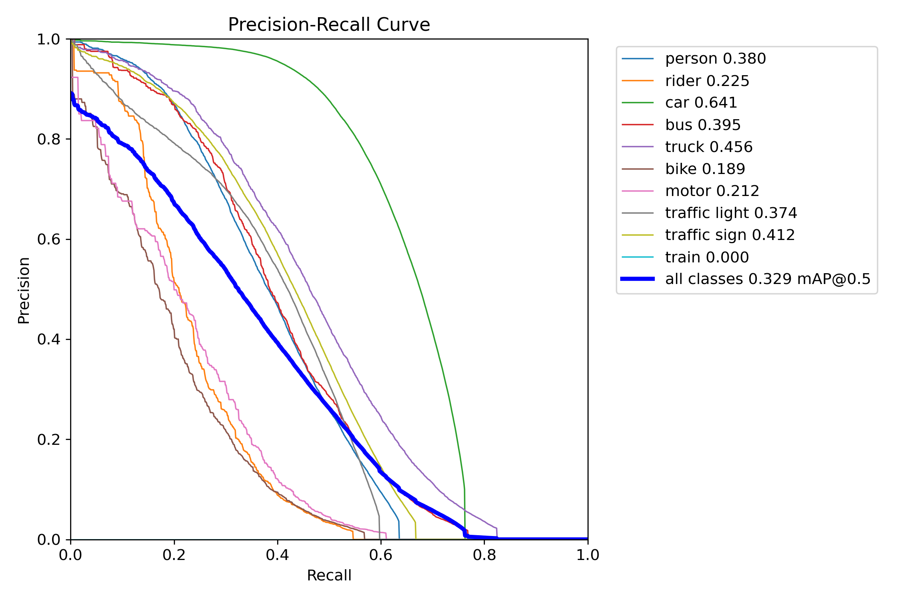
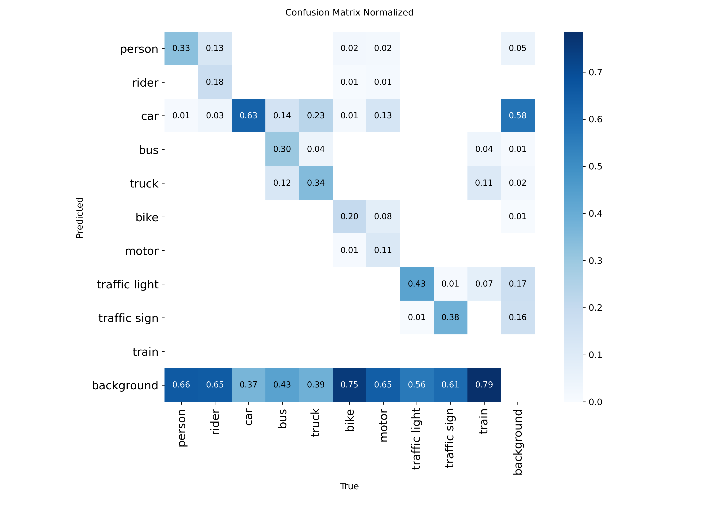
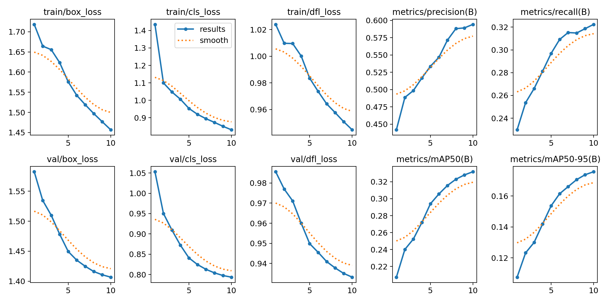

# ML-10: Object Detection II (YOLOv8)

โปรเจกต์นี้ใช้ **YOLOv8n** (Ultralytics) fine-tune บนชุดข้อมูล **BDD100K** (ภาพจากกล้องหน้ารถยนต์) เพื่อ **ตรวจจับวัตถุบนท้องถนน 10 คลาส** จากภาพเต็มโดยตรง (ค้นหาตำแหน่งและจำแนกคลาสพร้อมกัน) ครอบคลุมการเทรน การประเมินผล การทดสอบกับภาพ และการทดสอบแบบเรียลไทม์ด้วยเว็บแคม

> ต่างจาก ML-09 ที่เป็นเพียงตัวจำแนก crop จากกรอบที่ให้มา โมเดลใน ML-10 เป็น **object detector จริง** ที่ทำนายกรอบเอง

## 1. ภาพรวม

| หัวข้อ | รายละเอียด |
|---|---|
| โมเดล | YOLOv8n (pretrained `yolov8n.pt`) fine-tune บน BDD100K |
| งาน | Object detection 10 คลาส |
| ขนาดภาพ / batch | 480 px / 8 |
| ตัวชี้วัด | Precision, Recall, mAP50, mAP50-95 |
| ผลลัพธ์ | `best.pt`, `results.csv`, กราฟ PR/F1, confusion matrix, ภาพตัวอย่างการตรวจจับ |

## 2. ชุดข้อมูล

ใช้ [BDD100K (รูปแบบ YOLO) จาก Kaggle](https://www.kaggle.com/datasets/a7madmostafa/bdd100k-yolo)

| ส่วนข้อมูล | จำนวนภาพ |
|---|---:|
| Train | 70,000 |
| Validation | 10,000 |
| Test | มีในชุดข้อมูล (ไม่ได้ระบุจำนวน) |

**คลาส (10):** `person`, `rider`, `car`, `bus`, `truck`, `bike`, `motor`, `traffic light`, `traffic sign`, `train`

label เป็นรูปแบบ YOLO: `class x_center y_center width height` (ค่า 0–1) ไฟล์ `dataset/data.yaml` ระบุตำแหน่งข้อมูลและชื่อคลาส (ต้องแก้ค่า `path:` ให้ตรงกับตำแหน่งที่วางข้อมูลในเครื่อง)

## 3. โครงสร้างโปรเจกต์

```text
ML-10-Object Detection II/
├── dataset/
│   ├── train/{images,labels}/
│   ├── val/{images,labels}/
│   ├── test/{images,labels}/
│   └── data.yaml
├── runs/
│   ├── detect/runs/bdd100k/   # ผลการเทรน: weights/best.pt, results.csv, results.png, กราฟต่าง ๆ
│   ├── evaluation/            # ผลประเมินบนชุด test: PR curve, F1 curve, confusion matrix
│   └── image_test/            # ภาพตัวอย่างที่ตรวจจับแล้ว
├── train.py
├── evaluate.py
├── image_test.py
├── realtime_test.py
├── requirements.txt
└── README.md
```

| สคริปต์ | หน้าที่ |
|---|---|
| `train.py` | เทรน YOLOv8n และบันทึก checkpoint กับ log ทุก epoch |
| `evaluate.py` | ประเมินบนชุด test พิมพ์ Precision, Recall, mAP50, mAP50-95 |
| `image_test.py` | สุ่ม 5 ภาพจาก test ตรวจจับ วาดกรอบ และบันทึกใน `runs/image_test/` |
| `realtime_test.py` | ตรวจจับด้วยเว็บแคม (กด **Q** เพื่อออก) |

## 4. วิธีใช้งาน

**ติดตั้ง**
```bash
pip install -r requirements.txt
```
สคริปต์เลือกอุปกรณ์ประมวลผลอัตโนมัติ: **Intel Arc (XPU) → NVIDIA (CUDA) → CPU** และพิมพ์ `Using device: ...` ตอนเริ่มรัน การใช้ Intel GPU ต้องติดตั้ง PyTorch รุ่น XPU (`pip install torch torchvision --index-url https://download.pytorch.org/whl/xpu`) และใช้ Ultralytics รุ่น 8.4 ขึ้นไป

**เทรน**
```bash
python train.py --epochs 10 --fraction 0.1 --name bdd100k_v2
```
| ตัวเลือก | ความหมาย | ค่าเริ่มต้น |
|---|---|---|
| `--epochs` | จำนวนรอบการเทรน | 10 |
| `--fraction` | สัดส่วนข้อมูลเทรนที่ใช้ (0–1) | 1.0 |
| `--batch` | ขนาด batch | 8 |
| `--imgsz` | ขนาดภาพ | 480 |
| `--name` | ชื่อโฟลเดอร์ผลลัพธ์ (ไม่เขียนทับของเดิม ถ้าซ้ำจะต่อท้ายเลข) | `bdd100k_new` |

**ประเมินผล / ทดสอบ** (ใช้ `--weights` เลือกโมเดล ถ้าไม่ระบุจะใช้ `runs/detect/runs/bdd100k/weights/best.pt`)
```bash
python evaluate.py --weights "runs\detect\runs\bdd100k_v2\weights\best.pt"
python image_test.py        # สุ่ม 5 ภาพ กดปุ่มใดก็ได้เพื่อดูภาพถัดไป, q เพื่อออก
python realtime_test.py     # เว็บแคม กด Q เพื่อออก
```

## 5. ผลการทดลอง

### 5.1 โมเดลอ้างอิง (`bdd100k`) ที่มากับรายวิชา

ผลในหัวข้อนี้มาจากโมเดล `runs/detect/runs/bdd100k` ซึ่งเป็นโมเดลอ้างอิงที่ให้มาพร้อมรายวิชา (เทรน 10 epochs, imgsz 480, batch 8) **ไม่ได้เทรนโดยผู้จัดทำ** ตัวเลข mAP ต่อคลาสอ่านจากกราฟ `runs/evaluation/BoxPR_curve.png` (ประเมินบนชุด test)

**ภาพรวม**

| ตัวชี้วัด | ค่า | ที่มา |
|---|---:|---|
| mAP@0.5 (ทุกคลาส) | 0.329 | PR curve บนชุด test |
| F1 สูงสุด (ทุกคลาส) | 0.37 ที่ confidence 0.210 | F1 curve บนชุด test |
| Precision | 0.594 | `results.csv` epoch 10 (ชุด validation) |
| Recall | 0.322 | `results.csv` epoch 10 (ชุด validation) |
| mAP50 | 0.332 | `results.csv` epoch 10 (ชุด validation) |
| mAP50-95 | 0.176 | `results.csv` epoch 10 (ชุด validation) |

ค่า Precision, Recall, mAP50-95 บนชุด test ให้รัน `python evaluate.py` เพื่อให้ได้ตัวเลขโดยตรง

**AP@0.5 รายคลาส (ชุด test)**

| คลาส | AP50 |
|---|---:|
| car | 0.641 |
| truck | 0.456 |
| traffic sign | 0.412 |
| bus | 0.395 |
| person | 0.380 |
| traffic light | 0.374 |
| rider | 0.225 |
| motor | 0.212 |
| bike | 0.189 |
| train | 0.000 (ไม่มีตัวอย่างในชุด test) |

**พัฒนาการระหว่างเทรน** (`results.csv`, ชุด validation) mAP50 เพิ่มจาก 0.207 (epoch 1) เป็น 0.332 (epoch 10) และ val loss ลดลงทุก epoch แสดงว่าโมเดลยังเรียนรู้ต่อได้ถ้าเทรนนานขึ้น ใช้เวลาเทรนรวมประมาณ 11,981 วินาที (ราว 3.3 ชั่วโมง)





### 5.2 การทดลองเทรนด้วยตนเอง (Intel Arc B580)

ผู้จัดทำทดลองเทรนซ้ำบน Intel Arc B580 (`Using device: xpu:0`, PyTorch XPU, Ultralytics 8.4.182) เพื่อวัดความเร็วและทดสอบว่าสคริปต์ใช้งานได้จริง ทุกรอบใช้ imgsz 480, batch 8 และ `--fraction` คือสัดส่วนของข้อมูลเทรนที่ใช้ (การ validate ใช้ชุด validation ทั้งชุดเสมอ)

| รอบ (`--name`) | `--fraction` | `--epochs` | สถานะ | เวลาที่ใช้ |
|---|---:|---:|---|---|
| `speedtest` | 0.02 | 1 | หยุดก่อนจบ epoch แรก (ไม่มีผลความแม่นยำ) | ช่วงเทรนประมาณ 10 นาที (รวม warm-up รอบแรก) |
| `bdd100k_v2` | 0.4 | 30 | หยุดเองหลังเทรนไป 2 epochs | ประมาณ 46 นาทีต่อ epoch |
| `bdd100k_v2-2` | 0.1 | 10 | กำลังเทรน | ยังไม่ทราบ |

**ผลของรอบ `bdd100k_v2` (ชุด validation, `results.csv`)**

| Epoch | Precision | Recall | mAP50 | mAP50-95 |
|---:|---:|---:|---:|---:|
| 1 | 0.268 | 0.105 | 0.079 | 0.040 |
| 2 | 0.269 | 0.108 | 0.084 | 0.043 |

ผลหลัง 2 epochs ต่ำกว่าโมเดลอ้างอิงมาก เพราะยังอยู่ในช่วงเริ่มต้นของการเทรน (learning rate ยังอยู่ในช่วง warm-up 3 epochs) และหยุดเทรนก่อนครบ 30 epochs จึงยังสรุปประสิทธิภาพที่แท้จริงไม่ได้ ข้อสังเกตด้านความเร็ว: เวลาต่อ epoch รวมการ validate ภาพ 10,000 ภาพทุกรอบ ซึ่งไม่ลดตาม `--fraction` ดังนั้นการลดสัดส่วนข้อมูลเทรนน่าจะลดเวลาได้ไม่เป็นสัดส่วนกัน (ยังไม่ได้วัดเวลาแยกระหว่างเทรนกับ validate)

### 5.3 การวิเคราะห์

- **ตรวจจับ `car` ได้ดีที่สุด (AP50 0.641):** เป็นคลาสที่มีตัวอย่างมากที่สุดในข้อมูล คลาสที่มีตัวอย่างน้อยหรือวัตถุเล็ก (`bike` 0.189, `motor` 0.212, `rider` 0.225) ได้ค่าต่ำสุด
- **พลาดการตรวจจับเป็นปัญหาหลัก:** จาก confusion matrix (normalized) สัดส่วนของวัตถุจริงที่โมเดลไม่ตรวจพบ (ถูกจัดเป็น background) สูงในคลาสเล็ก เช่น `bike` 0.75, `person` 0.66, `rider` 0.65, `motor` 0.65, `traffic sign` 0.61 สอดคล้องกับค่า Recall ที่ต่ำ (0.322) ขณะที่ Precision สูงกว่า (0.594)
- **สับสนระหว่างยานพาหนะ:** รถบรรทุก (`truck`) ถูกทายเป็น `car` 0.23 และรถบัส (`bus`) ถูกทายเป็น `car` 0.14 เพราะรูปร่างคล้ายกันและโมเดลมีขนาดเล็ก
- **ค่า mAP50-95 ต่ำ (0.176) เทียบกับ mAP50 (0.332):** กรอบที่ทำนายยังไม่แม่นพอเมื่อเกณฑ์ IoU เข้มขึ้น
- **คลาส `train` ได้ 0:** ไม่มีตัวอย่างในชุด test จึงประเมินไม่ได้ ส่งผลให้ค่าเฉลี่ยทุกคลาสต่ำกว่าที่ควร
- **ผลลัพธ์ยังเพิ่มขึ้นทุก epoch:** การเทรนเพียง 10 epochs จึงยังไม่อิ่มตัว

## 6. ข้อจำกัด

1. ใช้ YOLOv8n ซึ่งเป็นรุ่นเล็กสุด ขนาดภาพ 480 px ทำให้วัตถุเล็กตรวจจับยาก
2. เทรนเพียง 10 epochs และผลมาจากการรันครั้งเดียว ไม่ได้ทำซ้ำหลายรอบ
3. ชุดข้อมูลมีคลาสไม่สมดุล (`car` มาก, `train`/`motor`/`bike` น้อย)
4. ตัวเลข AP รายคลาสในข้อ 5.1 อ่านจากกราฟ จึงเป็นค่าที่ปัดเศษแล้ว
5. `realtime_test.py` ใช้ `conf=0.25` และ `imgsz=640` ความเร็วขึ้นกับอุปกรณ์ ยังไม่ได้วัด FPS

**แนวทางต่อยอด:** ใช้โมเดลใหญ่ขึ้น (YOLOv8s/m), เพิ่มจำนวน epochs และขนาดภาพ, ถ่วงน้ำหนักคลาสหายาก, วิเคราะห์ข้อผิดพลาดรายคลาส, วัด FPS และทำเว็บสำหรับ deploy

## 7. อ้างอิง

- [BDD100K / Berkeley DeepDrive (Kaggle, รูปแบบ YOLO)](https://www.kaggle.com/datasets/a7madmostafa/bdd100k-yolo)
- [Ultralytics YOLOv8 Documentation](https://docs.ultralytics.com/models/yolov8/)
